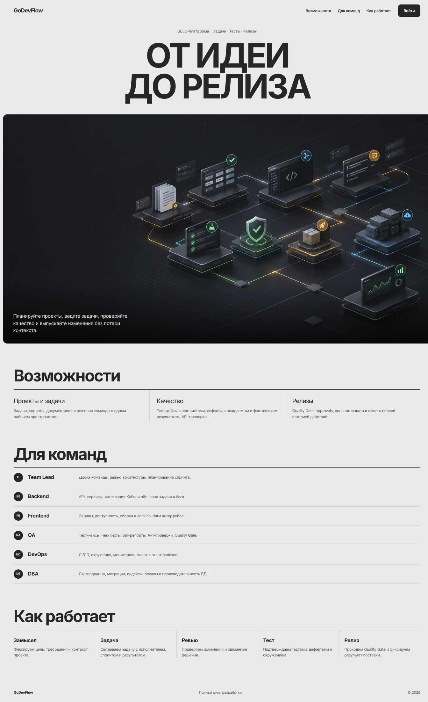

# GoDevFlow

GoDevFlow — внутренняя SDLC-платформа для управления проектами, задачами, качеством, релизами, интеграциями и виртуальными машинами.

## Краткое описание

GoDevFlow — платформа для управления полным жизненным циклом разработки программного обеспечения: от создания технической документации, формирования требований и постановки задач до разработки, Code Review, автоматизированного тестирования, сборки, развертывания и выкатывания готовой системы в Production.

Платформа объединяет управление проектами, документацией, задачами, тест-кейсами, дефектами, CI/CD, релизами, аналитикой качества и тестирования. Уникальной особенностью является мониторинг рабочего состояния разработчиков в течение дня: отслеживание загруженности, прогресса выполнения задач, доступности и возникающих трудностей. Это позволяет контролировать не только техническую готовность продукта, но и состояние команды на всех этапах разработки.

## Проблема

В процессе разработки программного обеспечения документация, управление задачами, написание кода, Code Review, тестирование и CI/CD часто существуют в разных системах. Из-за отсутствия единой платформы сложно отслеживать полный жизненный цикл разработки, контролировать готовность функциональности, своевременно обнаруживать дефекты и определять, можно ли выпускать новую версию продукта в Production.

Кроме того, руководителям команд сложно получать актуальную информацию о состоянии разработчиков в течение рабочего дня, оценивать их загруженность, отслеживать прогресс выполнения задач и своевременно выявлять возникающие проблемы, задержки и перегрузки. В результате снижается прозрачность рабочих процессов, усложняется планирование и увеличивается риск задержек релизов.

## Решение

GoDevFlow объединяет управление документацией, проектами, задачами, тест-кейсами, дефектами и релизами в одной платформе. Система охватывает весь жизненный цикл разработки: от создания документации до выкатывания готового продукта в Production.

Платформа интегрируется с Jenkins для CI/CD, Kafka для обмена событиями и n8n для автоматизации процессов. Quality Gate контролирует готовность продукта к релизу.

Уникальная особенность платформы — мониторинг рабочего состояния разработчиков в течение дня: загруженности, прогресса и возникающих трудностей.

## Функциональные требования

1. Создание проектов, документации и задач.
2. Управление исполнителями, сроками и статусами.
3. Мониторинг загруженности и состояния разработчиков.
4. Управление тест-кейсами и тестовыми прогонами.
5. Регистрация и отслеживание дефектов.
6. Интеграция с Jenkins, Kafka и n8n.
7. Автоматическая проверка качества через Quality Gate.
8. Управление релизами и развертыванием в Production.

## Нефункциональные требования

1. **Производительность** — быстрая обработка запросов.
2. **Безопасность** — авторизация и разграничение прав доступа.
3. **Надёжность** — сохранность данных и резервное копирование.
4. **Масштабируемость** — возможность увеличения нагрузки.
5. **Удобство** — понятный интерфейс и наглядная аналитика.
6. **Сопровождаемость** — модульная архитектура и документация API.
7. **Совместимость** — поддержка интеграций с внешними сервисами.
